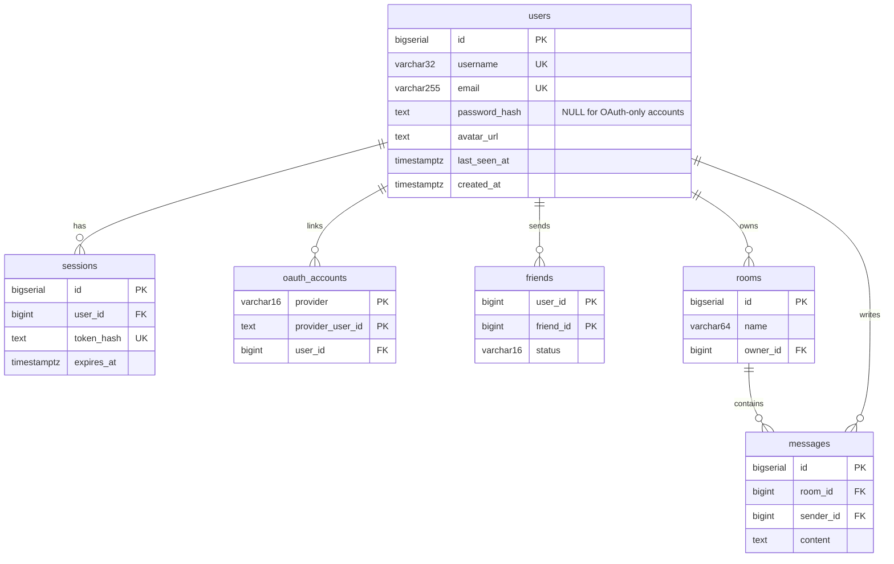

*This project has been created as part of the 42 curriculum by sberete.*

# SyncWatch

## Description

SyncWatch is a platform for watching videos together, in real time, from
anywhere: shared rooms with synchronized playback, a live chat, and a
social layer (friends, profiles, online status). It is this project's
answer to the `ft_transcendence` subject's open brief — instead of Pong,
the real-time core is a shared watch-room.

SyncWatch never hosts or streams copyrighted content itself. It only
aggregates videos from sources that explicitly allow it through a public
API — the Internet Archive (public-domain films) and PeerTube (freely
licensed videos) — and hands the browser a direct link to the source. The
server never stores or proxies the video stream.

Key features:
- Account system (email/username + password, or Google/GitHub OAuth)
- Friends (requests, accept/decline, online status)
- A video catalogue aggregated live from legal sources, with search and
  playback (MP4 and HLS)
- Watch rooms with a real-time chat (WebSocket), persisted history, and
  automatic cleanup when a room empties
- Privacy Policy and Terms of Service pages
- The whole site served over HTTPS behind an nginx reverse proxy

Synchronized playback (play/pause/seek shared across a room) is designed
(see `docs/websocket.md`) but not implemented yet — see "Modules" below
for the exact state of every claimed module.

## Instructions

### Prerequisites

- Docker and Docker Compose
- `make`
- For native backend development only (optional): Rust/Cargo, Node.js

### Setup

```bash
git clone <this-repository>
cd ft_transcendence
cp .env.example .env
```

Fill in `.env` with real values. At minimum, `POSTGRES_PASSWORD` should be
changed from the example. `GOOGLE_CLIENT_ID`/`GOOGLE_CLIENT_SECRET` and
`GITHUB_CLIENT_ID`/`GITHUB_CLIENT_SECRET` are optional — the OAuth buttons
stay visible but inactive without them. See the comments in `.env.example`
for where to obtain each value.

### Run everything in Docker (single command)

```bash
make up
```

Opens the site at **https://localhost:8080**. The certificate is
self-signed (generated at build time, not committed) — the browser will
show a security warning on first load; this is expected, accept it to
continue. `make down` stops everything, `make logs` tails every service,
`make clean` also removes the volumes (database and avatars are lost).

### Development mode

```bash
make dev
```

Runs PostgreSQL and the frontend in Docker, and the backend natively via
`cargo run` for fast recompiles. The site stays on the same address,
`https://localhost:8080` — nginx routes to the native backend instead of
the Docker one. Database migrations are applied automatically on backend
startup, in both modes.

`make dev` and `make up` cannot run at the same time in different
terminals: `make dev` stops the Docker backend container every time it
runs, so a `make up` left running elsewhere gets cut without warning.

### Tests

```bash
cargo test                 # unit tests, no database needed
cargo test -- --ignored    # + integration tests (needs the database running)
```

## Resources

Classic references used while building this project (full annotated list
in [`docs/resources.md`](docs/resources.md)):

- Rust: [The Rust Book](https://doc.rust-lang.org/book/), [Rust by Example](https://doc.rust-lang.org/rust-by-example/)
- Tokio: [official tutorial](https://tokio.rs/tokio/tutorial)
- Axum: [repository and examples](https://github.com/tokio-rs/axum), [API docs](https://docs.rs/axum)
- SQLx + PostgreSQL: [SQLx repository](https://github.com/launchbadge/sqlx), [PostgreSQL docs](https://www.postgresql.org/docs/)
- WebSockets: [RFC 6455](https://www.rfc-editor.org/info/rfc6455), [MDN WebSocket API](https://developer.mozilla.org/en-US/docs/Web/API/WebSocket)
- Security: [MDN CORS](https://developer.mozilla.org/en-US/docs/Web/HTTP/Guides/CORS), [OWASP Cheat Sheet Series](https://github.com/OWASP/CheatSheetSeries), [RFC 9106 (Argon2)](https://www.rfc-editor.org/rfc/rfc9106)
- OAuth 2.0: [RFC 6749](https://www.rfc-editor.org/rfc/rfc6749), [Google OAuth docs](https://developers.google.com/identity/protocols/oauth2/web-server), [GitHub OAuth docs](https://docs.github.com/en/apps/oauth-apps/building-oauth-apps/authorizing-oauth-apps)
- Frontend: [Vue 3 docs](https://vuejs.org/guide/introduction), [Vite docs](https://vite.dev), [Vue Router docs](https://router.vuejs.org/introduction)
- Playback: [hls.js](https://github.com/video-dev/hls.js)
- Catalogue sources: [Internet Archive Advanced Search API](https://archive.org/advancedsearch.php), [PeerTube REST API](https://docs.joinpeertube.org/api/rest-reference.html)
- Docker: [Compose file reference](https://docs.docker.com/reference/compose-file/)

### Use of AI

AI (Claude, through Claude Code) was used throughout this project as a
pair-programming assistant, not as an autonomous author:

- **Design**: discussing the concept, technology choices (Rust/Axum,
  PostgreSQL, Vue), and product decisions (e.g. the 4 room-behaviour
  choices in `docs/websocket.md` section 9) — always made or validated by
  me, never decided unilaterally by the AI.
- **Learning Rust**: a full set of warm-up exercises (not part of this
  repository) was used to learn the language before starting the project;
  those exercises were written and coded entirely by me, with the AI only
  providing the prompts, never the solutions.

## Team Information

| Member | Roles | Responsibilities |
|---|---|---|
| sberete | Product Owner, Project Manager, Technical Lead, Developer | All of them — this project is currently being built solo. The subject expects a 4-5 person team; roles will be reassigned and this section rewritten honestly if/when teammates join. |

## Project Management

With no team yet, there is no formal coordination process to describe.
Work is organized as:

- **Feature branches**, not person-based ones, so that a real teammate
  could pick up a specific piece of work later without inheriting a
  fabricated commit history: `rooms-rest`, `ws-core`, `frontend-chat`,
  `frontend-sync`, `compliance`, merged into `main` as they stabilize.
- **Git history** as the record of what was done and when — commit
  messages explain the *why*, not just the *what*.
- A private working journal (outside this repository) tracking decisions,
  open questions, and a day-by-day log, kept up to date as the project
  evolves.

## Technical Stack

- **Backend**: Rust + [Axum](https://github.com/tokio-rs/axum) 0.8 (switched from Actix-web early on), on the
  [Tokio](https://tokio.rs) async runtime. Chosen to build real depth in a systems language
  rather than defaulting to something more familiar.
- **Database**: PostgreSQL 16, accessed through [SQLx](https://github.com/launchbadge/sqlx) with hand-written SQL
  (`sqlx::query_as`, `#[derive(sqlx::FromRow)]`) and compile-time query
  checking — a deliberate choice over an ORM, for direct control over the
  exact queries run. The "ORM for the database" module was dropped as a
  result, rather than retrofitting one into already-stable, tested
  queries for a single point; see "Modules" for its replacement.
- **Frontend**: [Vue 3](https://vuejs.org) (Composition API, `<script setup>`) + [Vue Router](https://router.vuejs.org) 4 +
  [Vite](https://vite.dev). [hls.js](https://github.com/video-dev/hls.js) for HLS playback in browsers that don't support
  it natively.
- **Real time**: native WebSockets on Axum/Tokio (no Socket.IO or similar
  library) — connection handling, rate limiting, and custom close codes
  implemented directly against [RFC 6455](https://www.rfc-editor.org/info/rfc6455).
- **Infrastructure**: Docker Compose (`db`, `backend`, `frontend`
  services), nginx as a reverse proxy terminating HTTPS (self-signed
  certificate generated at image build time) and routing to the backend
  over the internal Docker network — the backend publishes no port of its
  own. A `Makefile` wraps the common commands.

## Database Schema

PostgreSQL 16, schema defined in `migrations/`, applied automatically on
backend startup.



Notes:
- A friendship is stored as two rows, one per direction, which keeps "my
  friends" a simple `WHERE user_id = me AND status = 'accepted'` query.
- `rooms` is deleted (cascading to its `messages`) as soon as its last
  member leaves — rooms are not meant to persist empty.
- A `videos` table exists in the first migration but is unused: uploading
  personal videos was considered and then dropped in favor of relying
  entirely on the external catalogue (see "Modules").

## Features List

All features below were designed and implemented by sberete (see "Team
Information").

| Feature | Description |
|---|---|
| Account system | Sign up / log in with email or username + password (Argon2, salted), log out, DB-backed sessions |
| OAuth login | Google and GitHub, popup-based flow, account linking on a verified email |
| Profile | View and edit username, upload an avatar |
| Friends | Send/accept/decline requests, friends list, online status |
| Video catalogue | Search and browse videos aggregated from Internet Archive and PeerTube |
| Playback | MP4 and HLS playback in-browser (hls.js), no server-side transcoding |
| Watch rooms | Create or join a room, WebSocket connection, live member list |
| Chat | Real-time messages in a room, persisted history with pagination |
| Privacy Policy / Terms of Service | Accessible from the footer on every page |
| HTTPS | Entire site served over TLS through an nginx reverse proxy |

## Modules

Target: 14 points (major = 2, minor = 1). Status reflects what is
genuinely functional today, not what is planned — a module claimed here
that turns out broken or incomplete is worth 0 points per the subject, so
this table is kept honest rather than aspirational.

| Module | Category | Points | Status |
|---|---|---|---|
| Real-time features (WebSockets) | Web, Major | 2 | **Done** — rooms, presence, chat and synchronized playback all implemented, verified both end-to-end on the protocol and visually across two real browser sessions (clock sync, drift correction, ownership transfer on owner departure) |
| Allow users to interact (chat, profile, friends) | Web, Major | 2 | **Done** |
| Standard user management | User Management, Major | 2 | **Done** |
| Recommendation system (ML) | Artificial Intelligence, Major | 2 | **Not started** |
| File upload and management | Web, Minor | 1 | **In progress** — avatar upload works (type/size validated server-side); still missing a real progress indicator and a delete action |
| Remote authentication (OAuth 2.0) | User Management, Minor | 1 | **Done** |
| Notification system | Web, Minor | 1 | **Not started** |
| Support for additional browsers | Accessibility, Minor | 1 | **In progress** — replaces the ORM module (dropped, see "Technical Stack"); Chrome, Brave and Safari have all been exercised manually during development, a systematic documented pass across browsers is still needed |
| Advanced search | Web, Minor | 1 | **In progress** — search with a source filter works; sorting/pagination not yet added |
| 2FA | User Management, Minor | 1 | **Not started** |

This currently totals less than 14 points if only "Done" rows are
counted; the remaining ones are being worked on. No bonus module is
claimed until the mandatory 14 points are solid, per the subject's rule
that bonus is only evaluated once the required part is perfect.

## Individual Contributions

Everything in this repository was built by **sberete**, working solo (see
"Team Information" for why). Breakdown by area:

- **Backend foundations**: Axum server setup, PostgreSQL pool, migrations,
  modular routing (`src/routes`), the `ApiError` → HTTP response mapping.
- **Authentication**: password auth (Argon2, DB-backed sessions), OAuth
  2.0 for Google and GitHub (authorization-code flow, account linking on
  verified email, CSRF-safe `state` parameter).
- **Social features**: user profiles, avatar upload, the friends system
  (bidirectional rows, request/accept flow).
- **Video catalogue**: the aggregator (`src/media`), querying Internet
  Archive and PeerTube in parallel, normalizing their responses into one
  shared format.
- **Real-time core**: the WebSocket protocol (`docs/websocket.md`), its
  implementation (`src/ws`, `src/rooms`), and the frontend chat/room UI
  (`roomSocket.js` and related views).
- **Infrastructure**: Docker Compose setup, the nginx reverse proxy and
  HTTPS termination, unifying the Docker and native-backend development
  workflows behind one URL.
- **Compliance**: Privacy Policy and Terms of Service pages, this README.

**Challenges faced and how they were resolved**:
- *Choosing Rust mid-piscine without prior experience in the language*:
  resolved by completing a dedicated set of warm-up exercises covering
  ownership, borrowing, traits, and error handling before writing any
  project code.
- *A silently stale backend IP cached by nginx after a container
  restart*, surfacing as an infinite loading screen with no clear error:
  found by comparing `docker inspect`'s `OOMKilled` flag (false) against
  the assumption of a crash, then tracing it to nginx's one-time DNS
  resolution of the Docker service name; fixed with dynamic resolution
  through Docker's embedded DNS.
- *A page/API path collision* (`/friends` existing as both a frontend
  route and a backend endpoint) once the frontend and the API were merged
  behind a single HTTPS origin: resolved by prefixing every API call with
  `/api`.
